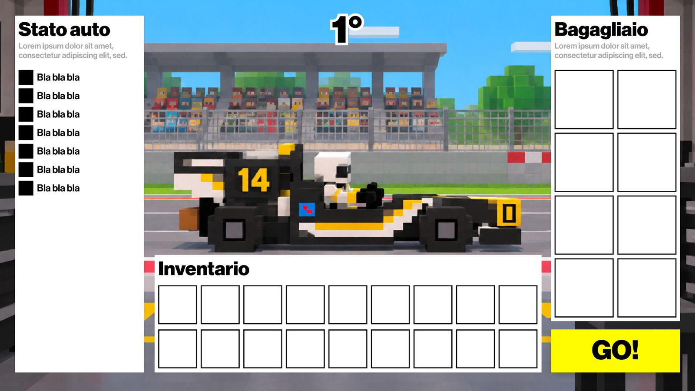
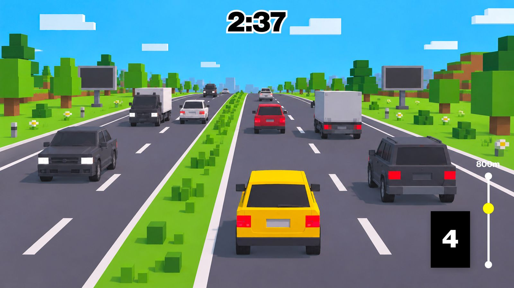
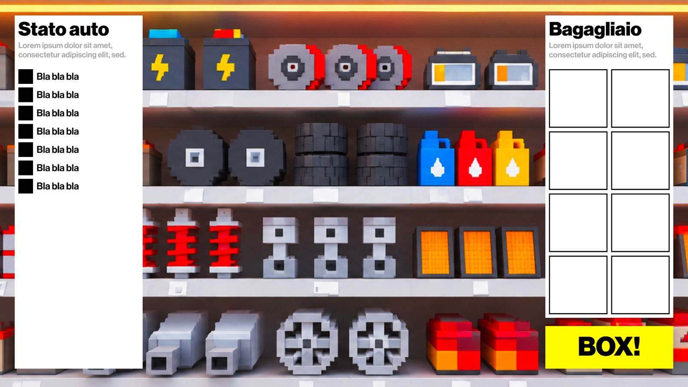

# Box! Box! BOX!

## Overview and vision statement

**Box! Box! BOX!** combines vehicle maintenance strategy with arcade driving. The player is a mechanic working for an exceptionally unlucky racing team: its car is the fastest on the track, but its components deteriorate every lap, and the pit crew has no spare parts.

To keep the car in the race, the player must assess its condition, drive to the nearby parts shop, and bring back the components needed for the next pit stop. Slots in the inventory are limited, so choosing the right parts matters as much as reaching the shop quickly.

The experience alternates between planning and driving. The central challenge is to balance immediate repairs with preventive maintenance while helping the team complete the race in the best possible position by reaching the parts shop as fast as possible.

The game will be developed in Unity 6.0. The team will create the visual and audio assets.

## Gameplay

### Player role and objective

The player manages spare-part supply for the racing team. The objective is to keep the car running until it completes all the required laps and to help the team achieve the best possible race result.

### Core gameplay loop

Each cycle consists of three phases:

1. **Manage parts and repair at the pits.** Review the current condition of the car's components, their predicted deterioration, and the time penalty expected for the next run. The planned repair interaction lets the player deposit spare parts from the vehicle's trunk into the separate pit inventory and replace components using either inventory. Check the remaining stock and plan what to collect next. Press **GO!** when ready to begin the supply run.

   

2. **Drive to the parts shop.** Navigate a road filled with obstacles by steering and changing gears to reach the shop as quickly as possible. The time spent on the run affects whether the racing team gains or loses positions.

   

3. **Advance the lap and load the trunk.** Arriving at the shop advances the race to the next lap and updates the car's condition by applying that lap's component deterioration. Choose which spare parts to load into the mechanic's vehicle trunk, taking its limited inventory slots into account. Press **BOX!** to return to the pits in the race phase, where the collected parts can be deposited into the pit inventory or used to replace car components alongside parts already stored at the pits.

   

The loop repeats until the final pit stop. **GO!** starts the drive to the shop, while **BOX!** returns the player from the shop to the pits. The lap and car-condition update occurs when the supply run is completed. On the final lap, **GO!** becomes **FINISH THE RACE!**: the player can review the remaining component penalty and finish the race without another supply run.

Scene changes use a fade transition. After a supply run, a popup reports positions gained, lost, or unchanged, together with the component penalty applied to that run.

### Strategic decisions

Component condition and deterioration forecasts help the player decide what to replace. A damaged part may require immediate attention, while another may still work but be likely to fail during an upcoming lap. The player must use this information to plan each supply run.

The player must also balance the parts needed immediately against supplies to keep at the pits for later laps. Trunk space is limited, so each shop visit requires choosing what to carry based on the car's condition and the parts already available at the box.

### Trunk and pit inventories

- **Trunk inventory:** Holds the spare parts selected at the shop and transported to the pits. It has a limited number of slots.
- **Pit inventory:** Stores spare parts deposited at the box and keeps them available for future repairs, separately from the trunk.
- **Repairs at the pits:** The player can replace car components using spare parts from either inventory. Loading a part at the shop does not install it on the race car; replacement takes place at the pits.

The current shop prototype supports dragging parts into inventory slots and hides the shelf item while it is being dragged. Component icons help distinguish the available items.

The race manager includes repair logic that restores a damaged component to 100% at the pits. Connecting this action to the inventory and consuming the replacement part still needs to be completed. The separate pit inventory and transfer flow remain part of the design; their complete implementation is not confirmed by the reviewed commits. Inventory capacities and the final balance of deterioration and penalties remain subject to playtesting.

### Component condition and penalties

The race car has twelve tracked components: tyres, front wing, rear wing, brakes, seat, steering wheel, pedals, gearbox, engine, suspension, helmet, and battery. Each component starts at 100% and loses a random amount of condition within its configured range after each completed supply run.

Damaged components add a time penalty to the supply run. Each part has its own maximum penalty, with the applied fraction determined by its condition:

| Component condition | Status colour | Fraction of maximum penalty |
| --- | --- | --- |
| 70-100% | Green | 0% |
| 40-69% | Yellow | 25% |
| 20-39% | Orange | 60% |
| 0-19% | Red | 100% |

The panel shows each component's condition, expected wear per lap, individual penalty, and the total penalty. The penalty for a supply run is taken from the component state at departure; wear applied after that run affects the next decision at the pits. These penalties represent the racing team's performance, separately from collisions involving the mechanic's supply vehicle.

### Controls

| Input | Action |
| --- | --- |
| A | Steer left |
| D | Steer right |
| Left mouse click | Shift up; the vehicle accelerates while in gear |
| Hold right mouse button | Brake; gears shift down automatically as speed falls |
| R | Reload the current scene in the driving prototype |
| GO! button | Confirm the plan and start the supply run |
| BOX! button | Return from the parts shop to the pits |
| FINISH THE RACE! button | Apply the final component penalty and show the race result |

The mouse-based driving controls replace the earlier W/S gear controls. Driving input is blocked during scene transitions and while the race-results screen is open.

### Race progression

Race progression is structured around individual laps. Completing an outward supply run advances the race by one lap and applies component deterioration before the shop phase. Pressing **BOX!** then returns the player to the pits with that updated state. The final lap ends at the pits without another drive to the shop.

The race car's condition and the time spent obtaining spare parts determine the team's performance. Quick, well-planned runs help the team remain competitive, while slow runs and unresolved component failures threaten its position.

The current prototype is configured for four laps and 32 competitors, with the player starting in 16th position. Each supply run covers 1,000 Unity units. Its driving time plus the departure component penalty is compared with a 60-second target, using 10 seconds per position and rounding the position change down. These are prototype values to balance through playtesting.

At the final pit stop, the remaining component penalty can only worsen or preserve the current position. The results screen distinguishes **VICTORY!** for first place, **PODIUM FINISH!** for second or third, and **RACE FINISHED** for other positions. It shows the final position and penalty, pauses gameplay, and offers retry and return-to-menu actions.

### Driving and collisions

The road is assembled from reusable sections selected from a pool and moved ahead as the player progresses. Traffic and changes of location are assigned development tasks; the reviewed commits do not yet confirm a complete implementation of either feature.

The supply vehicle has a collision and explosion prototype. After a collision, driving is temporarily disabled, the vehicle's parts react to the impact, and the car is rebuilt after a configured delay. Stronger impacts trigger the explosion behaviour. The player loses time recovering before continuing the supply run.

## Characters

- **The mechanic:** The player character, responsible for collecting and delivering spare parts under time pressure.
- **The racing driver:** Drives the team's race car and depends on the mechanic's deliveries to stay competitive.
- **The pit crew:** Supports the race car at the pits and uses the delivered components to carry out repairs.

These roles establish the gameplay context. Individual names, character designs, and personalities have not yet been defined.

## World

The game takes place around a race circuit and the roads connecting between it and a nearby parts shop. Three locations make the gameplay loop:

- **The pits:** The area where the player checks component condition, deposits spare parts from the trunk into the pit inventory, replaces components using either inventory, and prepares the next supply run.
- **The road:** The driving section, where obstacles challenge the player's reactions and speed.
- **The parts shop:** Arriving here advances the lap and updates the car's condition. The player chooses which spare parts to load into the trunk and clicks **BOX!** to return to the pits in the race phase.

### Visual style

The driving section uses a stylized 3D low-poly aesthetic, with **Crossy Road** as a visual reference. The pits and parts shop use 2D illustrations.

Component icons and inventory screens should have a simple visual language, keeping car condition, available parts, and race information easy to read.

The current interface uses Barlow and Barlow Condensed fonts. The car-status panel has a dark background, white component names, grey supporting information, and coloured condition percentages. The final pit button uses a chequered flag pattern to distinguish finishing the race from starting another run.

## Media list

This section lists the visual and audio assets needed for the game. These assets will be created by the team and imported into Unity. Visual assets will follow the established low-poly style.

### Visual assets

- Low-poly 3D model of the mechanic's supply vehicle.
- Low-poly environment models for the road and parts.
- 2D illustrations for the pit and parts shop.
- Low-poly road obstacles and scenery.
- Illustrations or icons for replaceable car components.
- Interface elements for components, deterioration forecasts, the separate trunk and pit inventories, part deposits and replacements, lap count, race position and supply-run time.
- **GO!**, **BOX!**, and **FINISH THE RACE!** buttons, plus menu, position popups, and race-results screens.
- Visual feedback for vehicle movement, collisions, component damage, and repairs, as required by the final presentation.

### Audio assets

- Engine and gear-change sounds for the driving sections. Found a v8 engine on github with shifting effect (made with an automation on BPMs) and edited it in ablethon to make it match a less potent V6 engine and with a different timbre, coherently with the concept of the game. Made by Massimiliano Bettarello
- Collision and driving feedback sounds.
- Interface sounds for selection, confirmation, and alerts.
- Audio cues for component problems and completed repairs.
- Background music and ambience for the planning and driving phases.

Christophe Karati's November 23 commit adds an FMOD prototype on the `AudioBox` branch, with acceleration and deceleration events for five gears and ten emitters connected in the driving scene. This work is not yet merged into the reviewed `dev` or `main` branches. Integration with the combined gameplay version and the remaining car sounds still needs to be checked.

## Technical specification

- **Game engine:** Unity 6.0 (6000.0.85f2 in the reviewed `dev` project), used to implement and assemble the complete game.
- **Programming language:** C# for gameplay logic and interactions.
- **Input:** Keyboard steering, mouse controls for gear changes and braking, and mouse interaction for planning and selecting parts.
- **Visual assets:** 3D models and 2D illustrations imported into Unity.
- **Audio integration:** FMOD for audio playback and integration with Unity. Audio assets are exported as WAV files.

## Team

| Team member | Role |
| --- | --- |
| Massimiliano Bettarello | Game Designer |
| Davide Crippa | Developer |
| Khalil Zribi | Developer |
| Riccardo Pilotto | Designer |
| Christophe Karati | Sound Designer |

## Deadlines

### Week 1

**Responsibility: whole team.** Explore Unity and the supporting tools needed to create the game. Identify possible solutions for technical and design aspects.

### Meeting 1 — October 21

Riccardo Pilotto wasn't able to join the call on meet.

Create a Dev branch on github for developers to work on separately, merge it to the main branch when the part is ready.

Took some minor gameplay and asset decisions. At the moment the interaction of the user with the inventory will be handled just through clicks. Next to newly substituted parts of the car will be written new in the car status.

We will start by working on the part of the game with the mechanic driving towards the parts shop.

### Week 2

Splitted tasks as follows:
- Massimiliano Bettarello: explore ffmod implementation with unity and design changing lanes/engine sounds in supercollider or a daw.
- Davide Crippa, Khalil Zribi: choose the type of inventory to use in unity and explore how to implement it.
- Riccardo Pilotto: change the livery of the racecar with red #B22029 and write E90 to the side, delete the grass between lanes (just the ""3D"" one, the flat one is ok), the assets are good so it's fine to start working on little things such as trees or the signs on the side of the road
- Christophe Karati: explore ffmod implementation with unity and design shift up/down sounds in supercollider or a daw.

### Meeting 2 - October 30

Confirmed that team will implement audio through fmod, took some minor decisions on how the 3D graphic part will look like (during the drive to the parts shop).
Decided which inventory to use, for compatibility the team will work on Unity 6.0.
Approved the sound design for the engine, the 3D model for the mechanc's car will be similar to a Fiat Panda.
The highway for the 3D part of the gameplay will probably be procedurally generated by loading chunks as the car goes on.

### Week 3

Splitted tasks as follows:
- Massimiliano Bettarello: work on the main menu, build the scenes in unity and connect them.
- Davide Crippa: implement the inventory in the spare parts shop scene.
- Khalil Zribi: implement the street scroll for the driving scene.
- Christophe Karati: work on the fmod implementation, work on the remaining audio assets for the car.
- Riccardo Pilotto: build a low poly 3D asset for the mechanic car and other components in the driving scene.

### Meeting 3 - November 6

Meeting with devs: Massimiliano Bettarello, Davide Crippa, Khalil Zribi.

Decided the list of parts which will be part of the spare parts shop:
- Tyres
- Front wing
- Rear wing
- Brake calipers
- Seat
- Steering wheel
- Pedals
- Gearbox
- Engine
- Suspension
- Helmet
- Battery

Took design decisions, the user will be able to change lanes smoothly, chunks are generated procedurally starting from prefabs and first protoype of the driving scene (made by Khalil Zribi).

Inventory implemented in the shop scene (made by Davide Crippa).

Main menu implemented and linking between different scenes (made by Massimiliano Bettarello).

Built a mechanic's car model based on the iconic Fiat Panda (made by Riccardo Pilotto).

### Week 4

Splitted tasks as follows:
- Massimiliano Bettarello: implement position, lap and race status manager.
- Davide Crippa: continue the shop scene implementation.
- Khalil Zribi: continue the driving scene implementation.
- Christophe Karati: start to implement audio in the project through fmod.
- Riccardo Pilotto: create the 2D illustrations for the box and the shop, secondairly work on car parts models for the inventory.

### Meeting 4 - November 14

Meeting with everyone, Riccardo Pilotto wasn't able to join in.

Assigned tasks, Christophe Karati will start the FMOD implementation this week.
Implemented positions, laps and race status manager. Improved the driving scene and controls for gear shifting.

### Week 5

Tasks split as follows:

- Massimiliano Bettarello: implement fading between scenes, logic for distance and times.
- Davide Crippa: continue the shop scene implementation.
- Khalil Zribi: continue the driving scene implementation.
- Christophe Karati: start to implement audio in the project through FMOD.
- Riccardo Pilotto: create the 2D illustrations for the box and the shop, secondly work on car parts models for the inventory.

### Development notes - November 22

Tasks split as follows:

- Massimiliano Bettarello: implement the transition to the victory/results screen, popups with position updates, component wear, and part repairs.
- Khalil Zribi: add traffic and changes of location to the driving section.
- Davide Crippa: implement the car explosion and add component icons.
- Christophe Karati: work on car sounds.
- Riccardo Pilotto: create the 2D illustrations for the box and the shop, secondly work on car parts models for the inventory.

### Progress update - November 28

Progress checked against the commits available on GitHub:

- Massimiliano Bettarello: added scene fades, supply-run timing, race progression and component wear. Added component penalties, position popups, final-pit behaviour, race results, and updated UI fonts. Repair logic is present, but the inventory interaction still needs to call it.
- Davide Crippa: added the shop inventory items and improved shelf dragging and layout. Developed the collision/explosion and vehicle reset behaviour, then added component icons and updated the shop scene.
- Khalil Zribi: improved driving visuals and controls, with changes merged into `main` and further driving-scene changes. Traffic and location changes remain to be confirmed.
- Christophe Karati: added the FMOD acceleration and deceleration prototype on `AudioBox`. The audio branch still needs integration with the current gameplay work.

## Changelog

| Date | Update |
| --- | --- |
| October 19, 2026 | Created the initial GDD. |
| October 22, 2026 | Updated deadlines and task assignments. |
| October 22, 2026 | Applied document style fixes. |
| October 25, 2026 | Expanded audio asset details and integration notes. |
| October 25, 2026 | Added prototype screenshots and revised asset descriptions. |
| October 31, 2026 | Added the Unity 6 project on `dev`. |
| October 31, 2026 | Added the main menu, driving, pit, and shop scenes on `dev`. |
| November 2, 2026 | Recorded the October 30 meeting, Unity 6.0 and FMOD decisions, revised visual assets, and November 6 tasks. |
| November 9, 2026 | Added Week 4 task assignments. |
| November 19, 2026 | Recorded the November 14 meeting and Week 5 tasks. |
| November 28, 2026 | Added the November 22 assignments and a progress update based on the team commits through November 26. |
| November 28, 2026 | Updated controls, component penalties, final-pit flow, race results, collisions, UI and audio status; distinguished implemented work from pending integration. |
