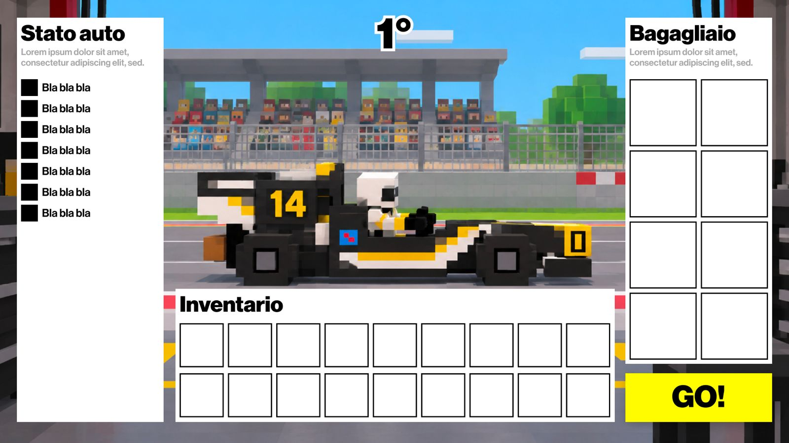
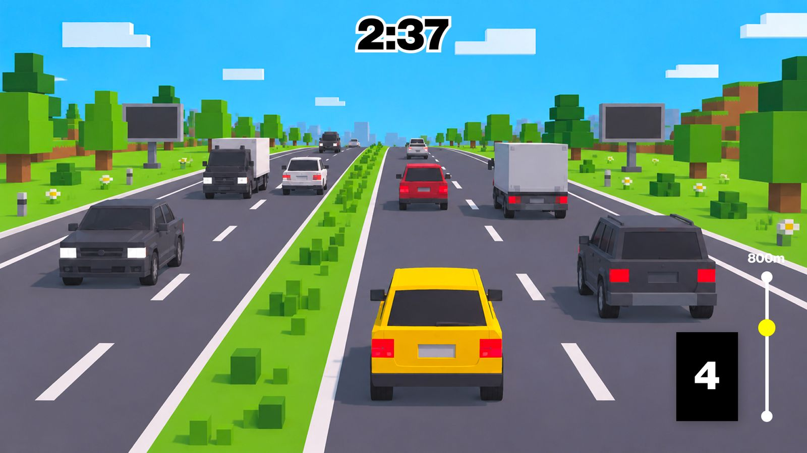
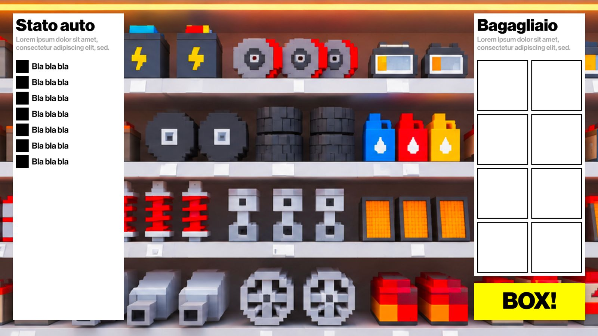

# Box! Box! BOX!

## Overview and vision statement

**Box! Box! BOX!** combines vehicle maintenance strategy with arcade driving. The player is a mechanic working for an exceptionally unlucky racing team: its car is the fastest on the track, but its components deteriorate every lap, and the pit crew has no spare parts.

To keep the car in the race, the player must assess its condition, drive to the nearby parts shop, and bring back the components needed for the next pit stop. Slots in the inventory are limited, so choosing the right parts matters as much as reaching the shop quickly.

The experience alternates between planning and driving. The central challenge is to balance immediate repairs with preventive maintenance while helping the team complete the race in the best possible position by reaching the parts shop as fast as possible.

The game will be developed in Unity 6.0. The team will create the visual and audio assets.

## Gameplay

### Player role and objective

The player manages spare-part supply for the racing team. The objective is to keep the car running until it completes all the required laps and to help the team achieve the best possible race result.

### Core gameplay loop

Each cycle consists of three phases:

1. **Manage parts and repair at the pits.** Review the current condition of the car's components and their predicted deterioration. Deposit spare parts from the vehicle's trunk into the separate pit inventory, and replace car components using parts available in either the trunk or the pit inventory. Check the remaining stock and plan what to collect next. Press **VAI!** when ready to begin the supply run.

   

2. **Drive to the parts shop.** Navigate a road filled with obstacles by steering and changing gears to reach the shop as quickly as possible. The time spent on the run affects whether the racing team gains or loses positions.

   

3. **Advance the lap and load the trunk.** Arriving at the shop advances the race to the next lap and updates the car's condition by applying that lap's component deterioration. Choose which spare parts to load into the mechanic's vehicle trunk, taking its limited inventory slots into account. Press **BOX!** to return to the pits in the race phase, where the collected parts can be deposited into the pit inventory or used to replace car components alongside parts already stored at the pits.

   

The loop repeats until the race ends. **VAI!** starts the drive to the shop, while **BOX!** takes the player from the mechanic/shop phase back to the race. The lap and car-condition update occurs upon arrival at the shop.

### Strategic decisions

Component condition and deterioration forecasts help the player decide what to replace. A damaged part may require immediate attention, while another may still work but be likely to fail during an upcoming lap. The player must use this information to plan each supply run.

The player must also balance the parts needed immediately against supplies to keep at the pits for later laps. Trunk space is limited, so each shop visit requires choosing what to carry based on the car's condition and the parts already available at the box.

### Trunk and pit inventories

- **Trunk inventory:** Holds the spare parts selected at the shop and transported to the pits. It has a limited number of slots.
- **Pit inventory:** Stores spare parts deposited at the box and keeps them available for future repairs, separately from the trunk.
- **Repairs at the pits:** The player can replace car components using spare parts from either inventory. Loading a part at the shop does not install it on the race car; replacement takes place at the pits.

The component types, deterioration rates, consequences of failure, exact trunk capacity, and any capacity limit for the pit inventory will be defined during prototyping.

### Controls

| Input | Action |
| --- | --- |
| A | Steer left |
| D | Steer right |
| W | Shift up |
| S | Shift down |
| VAI! button | Confirm the plan and start the supply run |
| BOX! button | Switch from the mechanic/shop phase back to the race |

### Race progression

Race progression is structured around individual laps. Component deterioration is applied once per lap: reaching the parts shop triggers the transition to the next lap and the corresponding new state of the car. Each completed outward supply run therefore advances the race by one lap. Pressing **BOX!** then returns the player to the race phase with that updated state.

The race car's condition and the time spent obtaining spare parts determine the team's performance. Quick, well-planned runs help the team remain competitive, while slow runs and unresolved component failures threaten its position.

## Characters

- **The mechanic:** The player character, responsible for collecting and delivering spare parts under time pressure.
- **The racing driver:** Drives the team's race car and depends on the mechanic's deliveries to stay competitive.
- **The pit crew:** Supports the race car at the pits and uses the delivered components to carry out repairs.

These roles establish the gameplay context. Individual names, character designs, and personalities have not yet been defined.

## World

The game takes place around a race circuit and the roads connecting between it and a nearby parts shop. Three locations make the gameplay loop:

- **The pits:** The area where the player checks component condition, deposits spare parts from the trunk into the pit inventory, replaces components using either inventory, and prepares the next supply run.
- **The road:** The driving section, where obstacles challenge the player's reactions and speed.
- **The parts shop:** Arriving here advances the lap and updates the car's condition. The player chooses which spare parts to load into the trunk and clicks **BOX!** to return to the pits in the race phase.

### Visual style

The driving section uses a stylized 3D low-poly aesthetic, with **Crossy Road** as a visual reference. The pits and parts shop use 2D illustrations.

Component icons and inventory screens should have a simple visual language, keeping car condition, available parts, and race information easy to read.

## Media list

This section lists the visual and audio assets needed for the game. These assets will be created by the team and imported into Unity. Visual assets will follow the established low-poly style.

### Visual assets

- Low-poly 3D model of the mechanic's supply vehicle.
- Low-poly environment models for the road and parts.
- 2D illustrations for the pit and parts shop.
- Low-poly road obstacles and scenery.
- Illustrations or icons for replaceable car components.
- Interface elements for components, deterioration forecasts, the separate trunk and pit inventories, part deposits and replacements, lap count, race position and supply-run time.
- **VAI!** and **BOX!** buttons, plus menu and race-results screens.
- Visual feedback for vehicle movement, collisions, component damage, and repairs, as required by the final presentation.

### Audio assets

- Engine and gear-change sounds for the driving sections. Found a v8 engine on github with shifting effect (made with an automation on BPMs) and edited it in ablethon to make it match a less potent V6 engine and with a different timbre, coherently with the concept of the game. Made by Massimiliano Bettarello
- Collision and driving feedback sounds.
- Interface sounds for selection, confirmation, and alerts.
- Audio cues for component problems and completed repairs.
- Background music and ambience for the planning and driving phases.

## Technical specification

- **Game engine:** Unity 6.0 (6000.0.85f1 in the current project), used to implement and assemble the complete game.
- **Programming language:** C# for gameplay logic and interactions.
- **Input:** Keyboard controls for driving, with mouse clicks for planning and selecting parts.
- **Visual assets:** 3D models and 2D illustrations imported into Unity.
- **Audio integration:** FMOD for audio playback and integration with Unity. Audio assets are exported as WAV files.

## Team

| Team member | Role |
| --- | --- |
| Massimiliano Bettarello | Game Designer |
| Davide Crippa | Developer |
| Khalil Zribi | Developer |
| Riccardo Pilotto | Designer |
| Christophe Karati | Sound Designer |

## Deadlines

### Week 1

**Responsibility: whole team.** Explore Unity and the supporting tools needed to create the game. Identify possible solutions for technical and design aspects.

### Meeting 1 — October 21

Riccardo Pilotto wasn't able to join the call on meet.

Create a Dev branch on github for developers to work on separately, merge it to the main branch when the part is ready.

Took some minor gameplay and asset decisions. At the moment the interaction of the user with the inventory will be handled just through clicks. Next to newly substituted parts of the car will be written new in the car status.

We will start by working on the part of the game with the mechanic driving towards the parts shop.

### Week 2

Splitted tasks as follows:
- Massimiliano Bettarello: explore ffmod implementation with unity and design changing lanes/engine sounds in supercollider or a daw.
- Davide Crippa, Khalil Zribi: choose the type of inventory to use in unity and explore how to implement it.
- Riccardo Pilotto: change the livery of the racecar with red #B22029 and write E90 to the side, delete the grass between lanes (just the ""3D"" one, the flat one is ok), the assets are good so it's fine to start working on little things such as trees or the signs on the side of the road
- Christophe Karati: explore ffmod implementation with unity and design shift up/down sounds in supercollider or a daw.

### Meeting 2 - October 30

Confirmed that team will implement audio through fmod, took some minor decisions on how the 3D graphic part will look like (during the drive to the parts shop).
Decided which inventory to use, for compatibility the team will work on Unity 6.0.
Approved the sound design for the engine, the 3D model for the mechanc's car will be similar to a Fiat Panda.
The highway for the 3D part of the gameplay will probably be procedurally generated by loading chunks as the car goes on.

### Week 3

Splitted tasks as follows:
- Massimiliano Bettarello: work on the main menu, build the scenes in unity and connect them.
- Davide Crippa: implement the inventory in the spare parts shop scene.
- Khalil Zribi: implement the street scroll for the driving scene.
- Christophe Karati: work on the fmod implementation, work on the remaining audio assets for the car.
- Riccardo Pilotto: build a low poly 3D asset for the mechanic car and other components in the driving scene.

### Meeting 3 - November 6

Meeting with devs: Massimiliano Bettarello, Davide Crippa, Khalil Zribi.

Decided the list of parts which will be part of the spare parts shop:
- Tyres
- Front wing
- Rear wing
- Brake calipers
- Seat
- Steering wheel
- Pedals
- Gearbox
- Engine
- Suspension
- Helmet
- Battery

Took design decisions, the user will be able to change lanes smoothly, chunks are generated procedurally starting from prefabs and first protoype of the driving scene (made by Khalil Zribi).

Inventory implemented in the shop scene (made by Davide Crippa).

Main menu implemented and linking between different scenes (made by Massimiliano Bettarello).

Built a mechanic's car model based on the iconic Fiat Panda (made by Riccardo Pilotto).

### Week 4

Splitted tasks as follows:
- Massimiliano Bettarello: implement position, lap and race status manager.
- Davide Crippa: continuo the shop scene implementation.
- Khalil Zribi: continue the driving scene implementation.
- Christophe Karati: start to implement audio in the project through fmod.
- Riccardo Pilotto: create the 2D illustrations for the box and the shop, secondairly work on car parts models for the inventory.

## Changelog

| Date | Update |
| --- | --- |
| October 19, 2026 | Created the initial GDD. |
| October 22, 2026 | Updated deadlines and task assignments. |
| October 22, 2026 | Applied document style fixes. |
| October 25, 2026 | Expanded audio asset details and integration notes. |
| October 25, 2026 | Added prototype screenshots and revised asset descriptions. |
| October 31, 2026 | Added the Unity 6 project on `dev`. |
| October 31, 2026 | Added the main menu, driving, pit, and shop scenes on `dev`. |
| November 2, 2026 | Recorded the October 30 meeting, Unity 6.0 and FMOD decisions, revised visual assets, and November 6 tasks. |